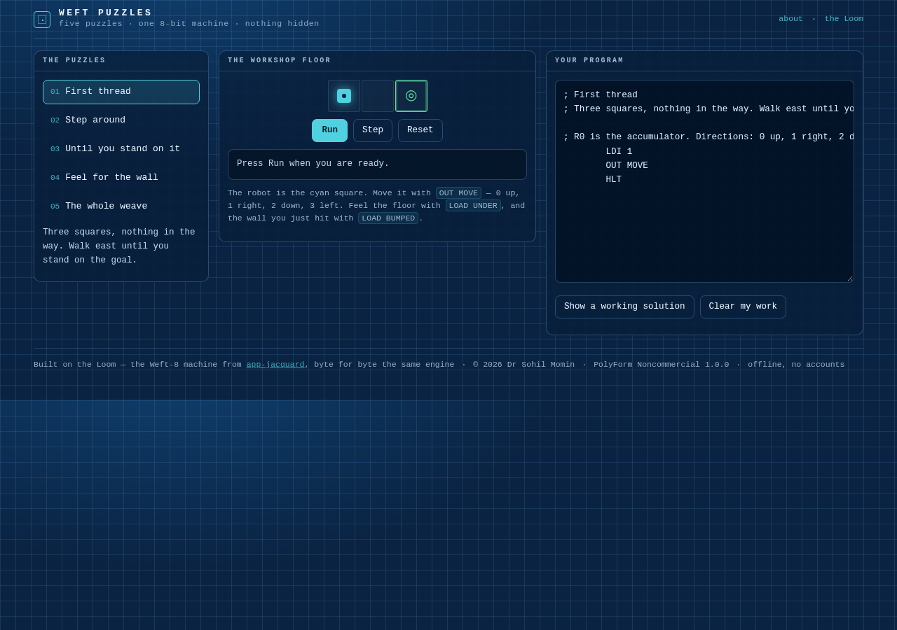

<div align="center">

# Weft Puzzles

<!-- shot:start -->



<!-- shot:end -->

**Six small programming puzzles, solved on a real 8-bit machine.**

[](https://drsamonline.github.io/app-weft-puzzles/)
[](https://github.com/drsamonline/app-weft-puzzles/actions/workflows/test.yml)
[](https://github.com/drsamonline/app-weft-puzzles/actions/workflows/build-apps.yml)
[](https://github.com/drsamonline/app-weft-puzzles/releases/latest)
[](LICENSE)
[-ffb454?style=flat-square&labelColor=0a2342)](https://github.com/drsamonline/app-jacquard)

[**Play it →**](https://drsamonline.github.io/app-weft-puzzles/) · [The machine it runs on](https://github.com/drsamonline/app-jacquard)

</div>


A robot on a grid, five puzzles, and a machine with sixteen registers, four flags and twenty-seven
instructions — **and no `if` statement**. So you build one, out of `CMP` and `JZ`. That is the whole
point of the puzzles: the constraint is the lesson.

## The six puzzles

| # | Puzzle | What it teaches |
|---|---|---|
| 01 | **First thread** | `LDI` puts a number in the accumulator, `OUT MOVE` hands it to the machine |
| 02 | **Step around** | four moves, three directions — a straight line is not always the answer |
| 03 | **Until you stand on it** | `LOAD` reads a port; `CMP` + `JZ` are how a machine decides |
| 04 | **Feel for the wall** | `BUMPED` is the machine's own feedback — a loop that reacts |
| 05 | **The whole weave** | a level can ask for more than arrival: collect both flags first |
| 06 | **The long way round** | three bump loops in a row — a program is a shape you repeat |

Each puzzle ships a **working solution**, and the test suite runs every one of them on the real
machine. A puzzle nobody has solved is a puzzle nobody knows is solvable — so that is asserted, not
assumed.

## Built on the Loom

This app does not carry its own computer. It runs the **Weft-8** from
[Jacquard (the Loom)](https://github.com/drsamonline/app-jacquard) — `docs/play/weft8.js` is that
engine, byte for byte the same file, and the same one its 102 assertions cover.

What this repository adds is a *world*: `docs/play/world.js` puts the machine inside a grid and hangs
seven ports off it, at `0xD0` and up so they never collide with the Loom's own `0xC0`–`0xCA`:

```
POS_X 0xD0  POS_Y 0xD1  UNDER 0xD2  MOVE 0xD3  BUMPED 0xD4  DONE 0xD5  BEEP 0xD6
```

So the machine is unchanged, and the puzzle is a peripheral — which is exactly how a real 8-bit
computer met the world.

## Run it

Open `docs/index.html`, or play the [live demo](https://drsamonline.github.io/app-weft-puzzles/).
Windows EXE and Android APK are on the [rolling release](https://github.com/drsamonline/app-weft-puzzles/releases/latest).

## Test it

```
npm install          # jsdom, test-only
node test-node.js    # 69 assertions: the machine, the world, and every level's solution
node tests/page-smoke.js   # 12 assertions: the page, driven in jsdom
```

The engine suite asserts that the machine is still the Loom's (two-byte encoding, 27 opcodes), that the
world obeys its own rules (walls refuse a move and set the bump flag, flags are taken once, the checker
knows a level with a flag left is not solved), that **every level's reference solution solves it in under
400 steps and fits the 128-byte ROM**, and that wrong answers are refused — walking into the wall,
stopping one square short, and guessing a corridor's length blind.

The page suite boots the real page, picks puzzles, runs programs, peeks at the solution and checks the
page says *Solved* — because a page that does not work is not a puzzle.


## The Weft-8 family

One machine, seven faces. Every one of these runs `weft8.js` from the Loom, byte for byte —
learn it once and you have learned all seven.

| | what it is |
|---|---|
| [the Loom](https://drsamonline.github.io/app-jacquard/) | the machine and its editor — where it all starts |
| **Weft Puzzles** (you are here) | five puzzles solved in assembly, a robot on a grid |
| [Clip Loom](https://drsamonline.github.io/app-clip-loom/) | clipboard programs you can read: strip, squeeze, wrap |
| [Weft-8 on hardware](https://drsamonline.github.io/weft8-hardware/) | the same machine in C, three-way parity with the JS one |
| [weft8-kit](https://drsamonline.github.io/weft8-kit/) | rules small enough to sign off |
| [Weft-8 Classroom](https://drsamonline.github.io/weft8-classroom/) | eight exercises that teach how a computer works |
| [Weft-8 beside x86 and ARM](https://drsamonline.github.io/weft8-compare/) | the same four jobs in three machines |

## Support


Free, offline, accountless — and staying that way. If it earned its keep:

| | |
|---|---|
| UPI (India) | `drsohilboi@ybl` — payee Dr. Sohil Momin, open amount, or scan [the QR](docs/assets/upi-qr.svg) |
| Ko-fi | [ko-fi.com/matneo](https://ko-fi.com/matneo) |
| PayPal | [paypal.me/drsohilmomin](https://paypal.me/drsohilmomin?locale.x=en_GB&country.x=IN) |
| My books | [Amazon author store](https://www.amazon.com/stores/author/B08ZT331LY/allbooks?ccs_id=aed72b9f-71d9-41dc-adee-e9368a317acc) |
| More apps | [drsamonline.github.io](https://drsamonline.github.io/) |
| Email | [sohilmomin2000@gmail.com](mailto:sohilmomin2000@gmail.com) |

Nothing is gated behind it: no accounts, no tracking, no network requests.

## Licence

**PolyForm Noncommercial 1.0.0** · © 2026 Dr Sohil Momin. Free for any noncommercial purpose.
